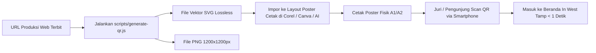

# Product Requirements Document (PRD)
# IN WEST TAMP: Integrated Wellness-Tourism Area Tampirkulon
**Platform Web Multi-Halaman & Sistem Informasi Terpadu Program PPK Ormawa**

---

## 1. Identitas dan Kontrol Dokumen

| Parameter | Detail Informasi |
|---|---|
| **Nama Produk** | IN WEST TAMP Web Platform (Integrated Wellness-Tourism Area Tampirkulon) |
| **Inisiator & Pengembang** | Tim PPK Ormawa Himpunan Mahasiswa Gizi (Himagi) Universitas Tidar 2025 |
| **Institusi Penaung** | Universitas Tidar (Untidar) & Direktorat Belmawa, Ditjen Diktisaintek, Kemendikbudristek |
| **Mitra Strategis Lapangan** | Pemerintah Desa Tampirkulon, POKDARWIS Desa Wisata Tampirkulon, Pengelola Westtamp Tubing, Basarnas, PMI, Puskesmas Candimulyo, BPPSDMP Kementan |
| **Kategori Penilaian Utama** | Poster Paling Kreatif (PPK Ormawa 2025) & Showcase Bukti Lapangan Berkelanjutan |
| **Status Dokumen** | Disetujui (Approved) |
| **Versi Dokumen** | 2.0.0 (Revamp: Multi-Page Platform with Supabase Backend) |
| **Tanggal Penyusunan** | 22 September 2026 |

---

## 2. Ringkasan Eksekutif dan Visi Produk

### 2.1 Ringkasan Eksekutif
IN WEST TAMP adalah platform web komprehensif yang mentransformasi poster cetak hasil pengabdian PPK Ormawa Himagi Untidar 2025 menjadi portal digital interaktif multi-halaman. Melalui pemindaian QR code pada poster fisik, juri penilai, wisatawan, akademisi, dan masyarakat luas diarahkan ke sebuah ekosistem digital terpadu yang didukung oleh backend Supabase. Platform ini menyajikan profil kelembagaan PPK Ormawa, latar belakang desa, 4 pilar program terintegrasi, tur virtual panorama 360 derajat 7 destinasi wisata, pembuktian luaran wajib/tambahan, serta galeri dokumentasi kegiatan lapangan yang dinamis.

### 2.2 Visi Produk
Mewujudkan portal showcase pengabdian masyarakat yang terpercaya, imersif, dan berkelanjutan, yang mampu membuktikan integrasi wisata air, kesehatan preventif (wellness), dan pemberdayaan ekonomi lokal di Desa Tampirkulon secara transparan dan terukur kepada seluruh pemangku kepentingan.

### 2.3 Misi Produk
1. Memberikan pengalaman pembuktian lapangan instan kepada juri penilai melalui tur virtual 360 derajat berbasis sensor gerak tanpa hambatan teknis.
2. Menyajikan laporan komprehensif mengenai latar belakang, 4 pilar intervensi, serta hasil dan luaran program secara terstruktur dalam arsitektur multi-halaman.
3. Membangun sistem pengelolaan konten yang mudah dimutakhirkan oleh tim mahasiswa dan pengurus desa menggunakan Supabase backend dan panel admin internal.
4. Menjadi aset digital permanen bagi POKDARWIS Desa Tampirkulon untuk melanjutkan promosi wisata pasca-program PPK Ormawa berakhir.

---

## 3. Latar Belakang Masalah dan Value Proposition

### 3.1 Problem Statement
1. **Keterbatasan Ruang Poster Fisik:** Poster kompetisi berukuran standar (A1/A2) hanya mampu menampung poin-poin infografis ringkas, tidak mampu memuat kronologi 5 bulan pengabdian, profil 15 mahasiswa, data dukung kelembagaan, serta ratusan dokumentasi kegiatan.
2. **Ketiadaan Validasi Lapangan Otentik:** Juri penilai PPK Ormawa sering kali hanya membaca klaim tertulis tanpa dapat memverifikasi kondisi fisik fasilitas yang dibangun (taman TOGA, sarana tubing, alat gym outdoor, dan sanggar budaya) secara visual 3D.
3. **Silo Informasi Program:** Informasi mengenai program PPK Ormawa nasional, profil ormawa pengusul, profil mitra, dan capaian program sering kali tercecer di berbagai dokumen laporan PDF terpisah yang jarang dibaca publik secara tuntas.
4. **Keberlanjutan Pasca-Program:** Banyak website pengabdian masyarakat berstatus statis (hardcoded) yang terbengkalai setelah kompetisi selesai karena ketiadaan sistem pengelolaan basis data terpusat.

### 3.2 Value Proposition
1. **The Creative Portal Bridge:** Menjadikan poster cetak sebagai pemicu (trigger) untuk membuka aplikasi web modern berkecepatan tinggi dalam waktu kurang dari 1 detik di layar smartphone juri.
2. **Immersive 360 Degree Field Proof:** Membawa juri langsung ke 7 titik lokasi binaan di Desa Tampirkulon menggunakan teknologi panorama WebGL Pannellum dan orientasi gyroscope HP.
3. **BaaS Powered Dynamism:** Penggunaan Supabase memungkinkan pembaruan angka metrik dampak, unggahan dokumentasi kegiatan, dan publikasi luaran baru tanpa perlu merilis ulang kode sumber web.
4. **Structured Multi-Page Narrative:** Menyusun alur cerita pengabdian secara elegan: dari landasan program PPK Ormawa, metodologi 4 pilar, komparasi kondisi sebelum vs sesudah, hingga pembuktian dokumen legalitas SK POKDARWIS dan SOP K3.

---

## 4. Profil Pengguna dan User Personas

### Persona 1: Juri Penilai PPK Ormawa (Primary Persona)
* **Profil:** Akademisi / reviewer Dikti yang menilai ratusan poster program pengabdian.
* **Perilaku & Karakteristik:** Waktu evaluasi sangat terbatas (1 hingga 3 menit per poster), kritis terhadap keaslian data, menuntut bukti nyata keberlanjutan program (bukan hanya seremonial).
* **Kebutuhan Utama:**
  * Memindai QR code poster dengan cepat tanpa login atau instalasi aplikasi.
  * Menemukan bukti visual fisik fasilitas lapangan (via tur 360 derajat).
  * Melihat data capaian kuantitatif terverifikasi dan kejelasan luaran wajib (SK POKDARWIS, SOP K3).
  * Menilai diferensiasi kreativitas media poster dibandingkan peserta lain.

### Persona 2: Calon Wisatawan & Pengunjung Umum (Secondary Persona)
* **Profil:** Masyarakat Magelang, Yogyakarta, dan sekitarnya yang mencari destinasi wisata alam dan edukasi ramah keluarga.
* **Perilaku & Karakteristik:** Mengakses web melalui pencarian media sosial atau brosur promosi di lokasi wisata.
* **Kebutuhan Utama:**
  * Mengetahui daya tarik wisata Westtamp Tubing, paket kuliner olahan lele, dan spot sunset.
  * Memperoleh kepastian standar keselamatan air (adanya sertifikasi K3 Basarnas dan pos kesehatan).
  * Mengetahui rute lokasi, kontak pengelola, dan informasi operasional.

### Persona 3: Pengurus POKDARWIS & Mitra Desa (Tertiary Persona)
* **Profil:** Pemuda karang taruna pengelola tubing dan perangkat Desa Tampirkulon.
* **Perilaku & Karakteristik:** Membutuhkan media promosi digital yang membanggakan desa mereka dan mudah dioperasikan.
* **Kebutuhan Utama:**
  * Wadah etalase resmi potensi desa yang terintegrasi.
  * Media untuk memperlihatkan legitimasi kelembagaan desa wisata kepada calon sponsor dan dinas pariwisata.

### Persona 4: Tim Pelaksana Himagi & Administrator Web
* **Profil:** Mahasiswa tim PPK Ormawa penanggung jawab publikasi dan pelaporan.
* **Kebutuhan Utama:**
  * Mengunggah foto dokumentasi kegiatan terbaru ke server dengan mudah.
  * Memperbarui angka statistik capaian (jumlah kunjungan, warga terlatih).
  * Mengelola pesan masuk dari buku tamu juri atau pengunjung.

---

## 5. Arsitektur Informasi dan Sitemap

Aplikasi menggunakan pendekatan Multi-Page Application (MPA) berbasis routing client-side React yang cepat dan terindeks dengan baik:

```
inwesttamp.vercel.app/
│
├── / (Beranda / Home Portal)
│   ├── Quick Hero & Poster Showcase
│   ├── Sekilas PPK Ormawa & In West Tamp
│   ├── Ringkasan 4 Pilar Terpadu
│   ├── Teaser Virtual Tour 360° (Direct Jump)
│   ├── Metrik Kunci Program Dalam Angka
│   ├── Sorotan Dokumentasi Lapangan
│   └── Baris Mitra Resmi
│
├── /tentang (Tentang Program & Lembaga)
│   ├── Mengenal PPK Ormawa Kemendikbudristek
│   ├── Profil Pengusul: Himagi Untidar
│   ├── Profil Geografis & Potensi Desa Tampirkulon
│   ├── Latar Belakang Masalah & Urgensi Intervensi
│   └── Struktur Tim Pelaksana & Dosen Pendamping
│
├── /program (Pelaksanaan 4 Pilar Program)
│   ├── Pilar 1: Tubing Care (Keselamatan K3 & Layanan Kesehatan)
│   ├── Pilar 2: West Integrated Ecosystem (POKDARWIS & Ekosistem Digital)
│   ├── Pilar 3: Local Creative Innovation (Pemberdayaan PKK/KWT & Olahan Lele)
│   ├── Pilar 4: Green Wellness Space (Taman TOGA & Area Terbuka Sehat)
│   └── Linimasa & Roadmap 5 Bulan Pengabdian
│
├── /luaran (Hasil, Capaian & Dampak)
│   ├── Luaran Wajib (SK POKDARWIS, SOP K3 Basarnas/PMI, Platform Web)
│   ├── Luaran Tambahan (Buku Resep Inovasi, Publikasi Media Massa, Video Profil)
│   ├── Tabel Komparasi Komprehensif (Kondisi Sebelum vs Sesudah)
│   └── Indikator Keberlanjutan Program (Sustainability Matrix)
│
├── /tur-360 (Virtual Tour Hub Dedikasi)
│   ├── Fullscreen / Adaptive 360° WebGL Viewer
│   ├── Selector 7 Spot Destinasi Terpadu
│   ├── Toggle Sensor Gerak Gyroscope Smartphone
│   ├── Peta Interaktif Sebaran Spot Desa Tampirkulon
│   └── Panel Informasi Detail Spot (Pilar Terkait, Fasilitas, Narasi)
│
├── /dokumentasi (Galeri & Arsip Kegiatan)
│   ├── Filter Kategori Kegiatan (K3, UMKM/PKK, Lingkungan, Budaya)
│   ├── Grid Foto High-Resolution dengan Lightbox
│   └── Video Dokumenter Kilas Balik Kegiatan
│
├── /kontak (Informasi Kunjungan & Buku Tamu)
│   ├── Panduan Rute & Aksesibilitas Menuju Desa Tampirkulon
│   ├── Kontak Person POKDARWIS & Pengelola Tubing
│   └── Formulir Interaktif Buku Tamu / Review Juri (Supabase Connected)
│
└── /admin (Sistem Manajemen Konten Terproteksi)
    ├── /admin/login (Otentikasi Pengurus via Supabase Auth)
    ├── /admin/dashboard (Ringkasan Statistik Sistem)
    ├── /admin/metrik (Form Pemutakhiran Angka Capaian)
    ├── /admin/dokumentasi (Upload Foto Kegiatan ke Supabase Storage)
    ├── /admin/luaran (Manajemen Berkas & Tautan Luaran)
    ├── /admin/destinasi-360 (Pengaturan Data 7 Spot Wisata)
    └── /admin/buku-tamu (Moderasi Pesan & Ulasan Masuk)
```

---

## 6. Spesifikasi Kebutuhan Fungsional (Functional Requirements)

### 6.1 Modul Portal Publik

#### FR-PUB-01: Header Navigasi & Identitas Institusi
* **Deskripsi:** Bilah atas yang memuat identitas legalitas program dan navigasi antar-halaman.
* **Spesifikasi:**
  * Menampilkan logo resmi beresolusi tinggi: Kemendikbudristek, Universitas Tidar, BLU Unggul Berbudaya, dan Desa Wisata Tampirkulon.
  * Badge identitas: "PPK ORMAWA 2025 | Himagi Untidar".
  * Menu navigasi responsif: Beranda, Tentang, Program, Luaran, Tur 360°, Dokumentasi, Kontak.
  * Tombol aksi khusus di navbar: "Jelajahi 360°".
  * Pada layar mobile (< 768px), navigasi atas disederhanakan dan didukung oleh Floating Dock di bawah layar.

#### FR-PUB-02: Hero Section & Quick Poster Action (Halaman Beranda)
* **Deskripsi:** Bagian pembuka halaman utama yang dirancang untuk memukau pengunjung dalam 2 detik pertama pasca-scan QR.
* **Spesifikasi:**
  * Judul utama tipografi display raksasa: `IN WEST TAMP` dengan aksen warna Solar Gold (`#E58B24`).
  * Sub-judul: "Integrated Wellness-Tourism Area Tampirkulon".
  * Indikator lokasi: "Desa Tampirkulon, Kec. Candimulyo, Kab. Magelang, Jawa Tengah".
  * Ringkasan demografis wilayah: Luas Wilayah 2.61 KM², Jumlah Penduduk ±4.893 Jiwa, 13 Dusun Terpadu.
  * Kartu pratinjau poster cetak resmi beresolusi tinggi dengan tombol tautan unduh/buka poster asli.
  * Dua tombol CTA utama: "Jelajahi Paket Wisata 360°" (mengarah ke `/tur-360`) dan "Lihat Capaian Program" (mengarah ke `/luaran`).

#### FR-PUB-03: Halaman Tentang PPK Ormawa & Lembaga (`/tentang`)
* **Deskripsi:** Menyediakan pemahaman komprehensif mengenai program pembinaan kemahasiswaan nasional dan konteks pengabdian.
* **Spesifikasi:**
  * Penjelasan resmi filosofi dan skema PPK Ormawa Belmawa Kemendikbudristek sebagai wadah penguatan kapasitas organisasi kemahasiswaan.
  * Profil Himpunan Mahasiswa Gizi (Himagi) Untidar, visi pengabdian, dan alasan keterlibatan bidang gizi/kesehatan dalam pengembangan desa wisata.
  * Uraian kondisi objektif awal Desa Tampirkulon sebelum intervensi (potensi air yang belum berstandar keselamatan, lahan tidur di basecamp, belum adanya kelembagaan POKDARWIS).
  * Struktur organisasi tim pelaksana: 15 mahasiswa berdedikasi lengkap dengan foto, nama, program studi, dan dosen pendamping lapangan.

#### FR-PUB-04: Halaman 4 Pilar Program (`/program`)
* **Deskripsi:** Paparan mendalam mengenai 4 pilar intervensi yang menjadi kerangka konseptual IN WEST TAMP.
* **Spesifikasi:**
  * **Pilar 1: Tubing Care:**
    * Detail pelatihan penyelamatan air (water rescue) bersama Basarnas Kantor SAR.
    * Pelatihan pertolongan pertama (P3K) bersama Palang Merah Indonesia (PMI).
    * Pelaksanaan Health Screening Day untuk pengelola dan wisatawan bersama Puskesmas Candimulyo.
    * Capaian: 25 pengelola tersertifikasi K3 dan 60 peserta skrining kesehatan.
  * **Pilar 2: West Integrated Ecosystem:**
    * Proses pendampingan penyusunan dan pengesahan SK Kepala Desa tentang Pembentukan POKDARWIS Tampirkulon.
    * Digitalisasi promosi melalui website dan peta paket wisata terpadu.
    * Capaian: 19 pengurus POKDARWIS aktif dan lonjakan kunjungan 95%.
  * **Pilar 3: Local Creative Innovation:**
    * Diversifikasi olahan pangan bergizi: pelatihan pembuatan nugget dan bakso lele untuk ibu-ibu PKK dan Kelompok Wanita Tani (KWT).
    * Standarisasi kemasan dan higienitas pada sentra keripik tempe dan gula jawa tradisional.
    * Capaian: 34 ibu PKK terlatih dan peluncuran paket eduwisata kuliner.
  * **Pilar 4: Green Wellness Space:**
    * Pembangunan fisik taman sehat seluas 21 m² di kawasan Basecamp Westtamp.
    * Penanaman 6 varietas Tanaman Obat Keluarga (TOGA).
    * Instalasi fasilitas olahraga luar ruang sederhana (outdoor gym) dan perintisan angkringan sehat ramah lingkungan.
  * Linimasa interaktif (roadmap) yang merangkum tahapan: Sosialisasi, Pelatihan, Pembangunan Fisik, Uji Coba Paket Wisata, dan Evaluasi Keberlanjutan.

#### FR-PUB-05: Halaman Hasil dan Luaran Program (`/luaran`)
* **Deskripsi:** Bukti konkret akuntabilitas program untuk penilaian juri dan dokumentasi ilmiah.
* **Spesifikasi:**
  * **Katalog Luaran Wajib:**
    * SK Legalitas POKDARWIS Desa Wisata Tampirkulon (tersedia tombol preview PDF).
    * Buku Pedoman SOP Keselamatan Wisata Air K3 Basarnas/PMI.
    * Platform Web Sistem Informasi Terpadu IN WEST TAMP.
  * **Katalog Luaran Tambahan:**
    * Buku Panduan Inovasi Resep Olahan Gizi Berbasis Ikan Lele & TOGA.
    * Arsip publikasi berita di media massa daring/cetak nasional dan lokal.
    * Video profil dokumenter desa wisata beresolusi 4K.
  * **Komparasi Sebelum vs Sesudah:** Komponen tabel dan kartu toggle interaktif yang membandingkan kondisi riil sebelum program vs hasil nyata pasca-intervensi pada aspek kelembagaan, keselamatan, ekonomi, dan lingkungan.
  * **Matriks Keberlanjutan (Sustainability):** Penjelasan rencana pemeliharaan mandiri oleh POKDARWIS pasca penarikan mahasiswa.

#### FR-PUB-06: Hub Tur Virtual 360 Derajat (`/tur-360`)
* **Deskripsi:** Fitur unggulan imersif untuk pembuktian lapangan 7 destinasi wisata desa.
* **Spesifikasi:**
  * **Engine:** Pannellum WebGL viewer tanpa plugin tambahan.
  * **Katalog 7 Spot Destinasi:**
    1. *Spot 1:* Sunset di Persawahan (Lanskap alam terasering senja).
    2. *Spot 2:* Basecamp Westtamp & Green Space (Pusat registrasi, Taman TOGA 21 m², Gym outdoor).
    3. *Spot 3:* Sentra Pembuatan Keripik Tempe (Eduwisata UMKM tradisional).
    4. *Spot 4:* Sentra Pembuatan Gula Jawa (Eduwisata proses nira kelapa kayu bakar).
    5. *Spot 5:* Wisata Budaya Karawitan (Sanggar pelestarian gamelan warga).
    6. *Spot 6:* Tuk Putri (Mata air alami konservasi).
    7. *Spot 7:* Jalur Susur Sungai Tubing (Arung jeram standar K3).
  * **Fitur Kontrol Penampil:**
    * Navigasi rotasi via sentuhan jari (swipe/drag) di ponsel dan klik-drag di desktop.
    * Pinch-to-zoom dengan pembatasan rentang FOV aman (50° hingga 110°).
    * Tombol Fullscreen layar penuh.
    * Tombol autorotate otomatis yang berhenti ketika layar disentuh pengguna.
    * **Sensor Gerak Gyroscope:** Menggunakan API `DeviceOrientation` dengan tombol aktivasi eksplisit dan penanganan izin pada browser iOS Safari / Android Chrome.
  * **Peta Interaktif Sebaran Spot (Village Interactive Map):**
    * Tampilan denah sebaran 7 titik lokasi di Desa Tampirkulon.
    * Pin aktif yang berkedip sesuai spot yang sedang dilihat di viewer.
    * Klik pin di peta otomatis mengganti panorama yang dimuat.
  * **Data Spot Dinamis:** Judul, kategori, deskripsi, fasilitas unggulan, dan status ketersediaan ditarik langsung dari tabel `destinations_360` di Supabase. Spot yang masih tahap pengembangan menampilkan badge informatif.

#### FR-PUB-07: Halaman Galeri Dokumentasi (`/dokumentasi`)
* **Deskripsi:** Arsip visual kegiatan lapangan beresolusi tinggi.
* **Spesifikasi:**
  * Tombol filter pilar: *Semua*, *K3 & Tubing*, *Kelembagaan POKDARWIS*, *Pelatihan PKK & UMKM*, *Taman Sehat & Lingkungan*.
  * Grid responsif yang menampilkan thumbnail seragam dengan efek hover zoom halus.
  * Komponen Lightbox: Klik foto membuka jendela popup layar penuh dengan caption kegiatan, tanggal, pilar terkait, dan navigasi foto berikutnya/sebelumnya.
  * Bagian Sematan Video: Pemutar video kilas balik dokumentasi 5 bulan pengabdian.
  * Sumber data foto bersumber dari tabel `documentation` dan berkas di Supabase Storage.

#### FR-PUB-08: Halaman Kontak & Buku Tamu Interaktif (`/kontak`)
* **Deskripsi:** Media interaksi dua arah antara pengunjung/juri dengan tim pengembang dan pengelola desa.
* **Spesifikasi:**
  * Informasi rute, peta navigasi Google Maps menuju Basecamp Westtamp, dan kontak WhatsApp POKDARWIS.
  * Formulir Buku Tamu Digital:
    * Input: Nama Pengunjung, Peran (Juri PPK Ormawa / Wisatawan / Dosen / Warga / Lainnya), Asal Instansi/Kota, Pesan & Masukan, dan Rating Bintang (1-5).
    * Submit terhubung langsung ke tabel `guestbook` di Supabase.
    * Menampilkan daftar ulasan yang telah dimoderasi secara real-time.

#### FR-PUB-09: Mobile Floating Navigation Dock
* **Deskripsi:** Komponen navigasi melayang di bawah layar pada perangkat smartphone (< 768px).
* **Spesifikasi:**
  * 4 tombol akses cepat dengan ikon SVG dan label ringkas:
    * 🏠 *Beranda*
    * 🧭 *Tur 360°*
    * 📊 *4 Pilar*
    * 🏆 *Luaran*
  * Posisi fixed di bagian bawah dengan safe-area-inset untuk menghindari bilah navigasi bawaan iPhone/Android.

---

### 6.2 Modul Panel Admin Terproteksi (`/admin`)

#### FR-ADM-01: Otentikasi Administrator (`/admin/login`)
* **Deskripsi:** Gerbang masuk aman khusus pengurus PPK Ormawa dan admin desa.
* **Spesifikasi:**
  * Login menggunakan email dan kata sandi via Supabase Auth.
  * Proteksi rute (Protected Route) pada seluruh sub-halaman `/admin/*` menggunakan React Router guard.
  * Sesi otomatis disimpan pada local storage terenkripsi dan ditangani oleh Supabase session listener.
  * Fitur logout yang menghapus sesi dan mengarahkan kembali ke halaman login.

#### FR-ADM-02: Dashboard Ringkasan (`/admin/dashboard`)
* **Deskripsi:** Panel status ringkas mengenai data yang tersimpan di sistem.
* **Spesifikasi:**
  * Menampilkan kartu ringkasan: Total Foto Dokumentasi, Total Metrik Aktif, Total Spot 360 Siap, Total Pesan Buku Tamu Masuk.
  * Tautan navigasi cepat ke form pengelolaan masing-masing modul.

#### FR-ADM-03: Pengelolaan Metrik Capaian (`/admin/metrik`)
* **Deskripsi:** Antarmuka pembaruan angka statistik dampak program.
* **Spesifikasi:**
  * Menampilkan daftar metrik aktif (misal: 4 Pilar, 15 Mahasiswa, 5 Bulan, 95% Kunjungan, 25 Pengelola K3).
  * Modal/Form inline untuk mengedit nilai numerik, satuan, dan deskripsi label.
  * Perubahan langsung tersimpan ke Supabase dan langsung tampil pada `/` dan `/luaran`.

#### FR-ADM-04: Pengelolaan Galeri Dokumentasi (`/admin/dokumentasi`)
* **Deskripsi:** Fasilitas pengunggahan dan kategorisasi foto kegiatan lapangan.
* **Spesifikasi:**
  * Input form: Judul Foto, Tanggal Kegiatan, Pilihan Kategori Pilar (Dropdown relasi tabel `pillars`), Caption/Keterangan.
  * Komponen file dropzone untuk mengunggah berkas foto (JPG/PNG, kompresi otomatis client-side hingga maks 2MB).
  * Berkas otomatis diunggah ke Supabase Storage bucket `activity-photos` dan URL publiknya disimpan ke tabel `documentation`.
  * Tabel daftar dokumentasi yang dilengkapi tombol hapus dan edit keterangan.

#### FR-ADM-05: Pengelolaan Luaran Program (`/admin/luaran`)
* **Deskripsi:** Mengelola dokumen SK, panduan resep, dan publikasi media.
* **Spesifikasi:**
  * Form input: Judul Luaran, Kategori (Wajib / Tambahan), Deskripsi Singkat, Pilihan Berkas PDF atau Tautan URL Luar.
  * Unggah berkas dokumen ke bucket `document-assets` di Supabase Storage.
  * Pengaturan visibilitas publik (tampilkan/sembunyikan).

#### FR-ADM-06: Pengelolaan Data Spot 360 Derajat (`/admin/destinasi-360`)
* **Deskripsi:** Pengaturan status ketersediaan foto dan narasi 7 spot wisata desa.
* **Spesifikasi:**
  * Mengedit nama spot, kategori, dusun, dan deskripsi keunikan.
  * Toggle status ketersediaan foto (`is_available` true/false).
  * Unggah foto panorama equirectangular baru ke bucket `panoramas-360` saat spot baru selesai dipotret.
  * Penyesuaian koordinat titik X dan Y pada peta mini desa.

#### FR-ADM-07: Moderasi Buku Tamu & Ulasan (`/admin/buku-tamu`)
* **Deskripsi:** Memeriksa pesan kesan yang dikirim oleh juri dan pengunjung.
* **Spesifikasi:**
  * Menampilkan daftar pesan masuk urut waktu terbaru (nama, instansi, rating, isi pesan).
  * Toggle status persetujuan publik (`is_approved`: true/false) untuk mencegah spam tampil di halaman depan.
  * Tombol hapus untuk pesan tidak pantas.

---

## 7. Desain Skema Database Supabase dan Storage

Database menggunakan PostgreSQL bawaan Supabase dengan Row Level Security (RLS) terpasang.

### 7.1 Struktur Tabel Database

#### Tabel 1: `pillars` (Informasi 4 Pilar Program)
```sql
CREATE TABLE public.pillars (
    id TEXT PRIMARY KEY, -- 'tubing-care', 'integrated-ecosystem', 'local-creative', 'green-wellness'
    name TEXT NOT NULL,
    tagline TEXT,
    tag_color TEXT NOT NULL, -- Hex code: #2D6A4F, #E58B24, dll.
    summary TEXT NOT NULL,
    before_condition TEXT NOT NULL,
    intervention TEXT NOT NULL,
    after_condition TEXT NOT NULL,
    key_metrics JSONB DEFAULT '[]'::jsonb,
    order_index INT DEFAULT 0,
    created_at TIMESTAMPTZ DEFAULT timezone('utc'::text, now()) NOT NULL
);
```

#### Tabel 2: `destinations_360` (Katalog 7 Spot Wisata 360°)
```sql
CREATE TABLE public.destinations_360 (
    id TEXT PRIMARY KEY, -- 'spot-1' sampai 'spot-7'
    name TEXT NOT NULL,
    category TEXT NOT NULL,
    dusun TEXT NOT NULL,
    pillar_id TEXT REFERENCES public.pillars(id) ON DELETE SET NULL,
    panorama_url TEXT NOT NULL,
    thumbnail_url TEXT NOT NULL,
    description TEXT NOT NULL,
    highlights TEXT[] DEFAULT '{}',
    map_coord_x NUMERIC NOT NULL, -- Persentase 0-100 koordinat X di peta desa
    map_coord_y NUMERIC NOT NULL, -- Persentase 0-100 koordinat Y di peta desa
    is_available BOOLEAN DEFAULT false,
    order_index INT DEFAULT 0,
    created_at TIMESTAMPTZ DEFAULT timezone('utc'::text, now()) NOT NULL
);
```

#### Tabel 3: `metrics` (Angka Capaian Dampak Kuantitatif)
```sql
CREATE TABLE public.metrics (
    id TEXT PRIMARY KEY,
    label TEXT NOT NULL,
    value TEXT NOT NULL, -- '4', '15', '5', '6', '95%', '25'
    unit TEXT, -- 'Pilar', 'Mahasiswa', 'Bulan', 'Kelompok Sasaran', 'Lonjakan', 'Pengelola K3'
    description TEXT,
    order_index INT DEFAULT 0,
    updated_at TIMESTAMPTZ DEFAULT timezone('utc'::text, now()) NOT NULL
);
```

#### Tabel 4: `documentation` (Galeri Foto & Video Kegiatan)
```sql
CREATE TABLE public.documentation (
    id UUID PRIMARY KEY DEFAULT gen_random_uuid(),
    title TEXT NOT NULL,
    pillar_id TEXT REFERENCES public.pillars(id) ON DELETE SET NULL,
    image_url TEXT NOT NULL,
    activity_date DATE NOT NULL,
    caption TEXT NOT NULL,
    is_featured BOOLEAN DEFAULT false,
    created_at TIMESTAMPTZ DEFAULT timezone('utc'::text, now()) NOT NULL
);
```

#### Tabel 5: `deliverables` (Daftar Luaran Wajib & Tambahan)
```sql
CREATE TABLE public.deliverables (
    id UUID PRIMARY KEY DEFAULT gen_random_uuid(),
    category TEXT NOT NULL CHECK (category IN ('wajib', 'tambahan')),
    title TEXT NOT NULL,
    description TEXT NOT NULL,
    file_or_link_url TEXT,
    is_external_link BOOLEAN DEFAULT false,
    icon_name TEXT,
    order_index INT DEFAULT 0,
    created_at TIMESTAMPTZ DEFAULT timezone('utc'::text, now()) NOT NULL
);
```

#### Tabel 6: `guestbook` (Buku Tamu & Masukan Juri/Pengunjung)
```sql
CREATE TABLE public.guestbook (
    id UUID PRIMARY KEY DEFAULT gen_random_uuid(),
    sender_name TEXT NOT NULL,
    sender_role TEXT NOT NULL, -- 'Juri PPK Ormawa', 'Wisatawan', 'Akademisi', 'Warga'
    sender_institution TEXT,
    message TEXT NOT NULL,
    rating INT CHECK (rating >= 1 AND rating <= 5),
    is_approved BOOLEAN DEFAULT true,
    created_at TIMESTAMPTZ DEFAULT timezone('utc'::text, now()) NOT NULL
);
```

### 7.2 Konfigurasi Supabase Storage Buckets
1. **`panoramas-360` (Public):** Menyimpan gambar equirectangular 2:1 dengan batas ukuran maks 8MB per berkas.
2. **`activity-photos` (Public):** Menyimpan foto dokumentasi lapangan dengan batas ukuran maks 3MB per berkas.
3. **`document-assets` (Public):** Menyimpan berkas PDF SK POKDARWIS, SOP K3, dan buku saku dengan batas ukuran maks 10MB per berkas.

### 7.3 Kebijakan Keamanan (Row Level Security / RLS)
* **Hak Akses Publik (`anon` role):**
  * `SELECT` diizinkan pada tabel: `pillars`, `destinations_360`, `metrics`, `documentation`, `deliverables`, dan `guestbook` (khusus baris `is_approved = true`).
  * `INSERT` diizinkan pada tabel `guestbook` (dengan validasi sanitasi teks).
* **Hak Akses Pengurus (`authenticated` role via Supabase Auth):**
  * Hak penuh `ALL` (`SELECT`, `INSERT`, `UPDATE`, `DELETE`) pada seluruh tabel dan seluruh storage bucket.

---

## 8. Spesifikasi Kebutuhan Non-Fungsional (Non-Functional Requirements)

### 8.1 Performa dan Edge Delivery (NFR-PERF)
1. **First Contentful Paint (FCP):** Kurang dari 1.0 detik pada koneksi seluler 4G LTE standar.
2. **Time to Interactive (TTI):** Kurang dari 2.0 detik.
3. **Bundle Size:** Aset JavaScript inti awal kurang dari 150 KB gzip melalui pemisahan bundle kode (*code splitting*) per rute halaman di React.
4. **Lazy Loading:** Aset foto panorama 360 resolusi tinggi dan galeri foto hanya dimuat ketika pengguna menavigasi ke bagian tersebut (*on-demand loading*).
5. **Caching:** Memanfaatkan edge caching pada CDN penyedia hosting (Vercel / Cloudflare Pages) untuk seluruh file statis dan gambar.

### 8.2 Ergonomi Mobile-First dan Responsivitas (NFR-MOB)
1. **Target Utama Pengguna:** 90%+ pengunjung mengakses pertama kali dari smartphone setelah memindai QR poster cetak.
2. **Rentang Viewport:** Tampilan harus sempurna tanpa patahan layout dari layar terkecil 320px (iPhone SE generasi awal), 375px-430px (iPhone & Android modern), tablet 768px, hingga desktop 1440px+.
3. **Zero Horizontal Overflow:** Tidak boleh terjadi pergeseran horizontal yang tidak disengaja (*horizontal scroll trap*) pada seluruh resolusi.
4. **Touch Target Size:** Semua elemen yang dapat diklik (tombol, link, thumbnail, kontrol viewer) memiliki ukuran area sentuh minimum 44px x 44px sesuai pedoman WCAG.
5. **Pannellum Touch Handling:** Rotasi panorama sentuh tidak boleh menahan *scroll vertikal* halaman pada saat pengguna ingin menggulir ke section berikutnya.

### 8.3 Aksesibilitas dan Standar Visual (NFR-A11Y)
1. **Standar WCAG:** Memenuhi pedoman WCAG 2.1 Level AA.
2. **Rasio Kontras Warna:**
   * Teks utama putih (`#F9FAFB`) di atas kanvas gelap (`#0A0F0D`): Rasio 18.9:1 (jauh melampaui standar 4.5:1).
   * Teks perak (`#D1D5DB`) di atas permukaan kartu (`#141E18`): Rasio 12.6:1.
   * Teks abu hangat (`#9CA3AF`) untuk caption kecil: Rasio 7.1:1.
3. **Focus Visible:** Setiap elemen interaktif memiliki indikator fokus keyboard `outline: 3px solid #E58B24; outline-offset: 3px`.
4. **Alt Text:** Seluruh elemen gambar memiliki atribut `alt` deskriptif untuk pembaca layar (screen reader).
5. **Reduced Motion:** Mendukung kueri CSS `@media (prefers-reduced-motion: reduce)` yang mematikan transisi berat dan autorotate bagi pengguna dengan sensitivitas vestibular.

### 8.4 Kompatibilitas Browser dan Sensor (NFR-COMPAT)
1. **Dukungan Browser:** Safari iOS (14+), Google Chrome Android/Desktop (90+), Mozilla Firefox, Microsoft Edge, dan Samsung Internet.
2. **Penanganan API Sensor Gyroscope:**
   * Deteksi dukungan `DeviceOrientationEvent` secara aman.
   * Pada browser iOS 13+, sediakan permintaan izin eksplisit via `DeviceOrientationEvent.requestPermission()`.
   * Jika sensor tidak didukung atau pengguna menolak izin, viewer otomatis kembali ke mode sentuh manual tanpa pesan galat yang mengganggu.

### 8.5 Keamanan dan Keandalan (NFR-SEC)
1. **Protokol:** Enkripsi penuh HTTPS (TLS 1.3).
2. **Autentikasi:** Menggunakan Json Web Token (JWT) standar Supabase Auth dengan penanganan refresh token otomatis.
3. **Sanitasi Input:** Seluruh input form publik (buku tamu) disanitasi dari potensi serangan Cross-Site Scripting (XSS) dan SQL Injection.
4. **Ketersediaan (Uptime):** Arsitektur serverless edge deployment menjamin ketersediaan sistem 99.9%.

---

## 9. Sistem Desain dan Identitas Visual

Sistem visual platform mengadaptasi penuh spesifikasi [desain.md](file:///home/aniiporangbaik/development/projects/Landing%20Page%20Poster/desain.md) dengan dial **ENERGY 3 / RHYTHM 3 / MOTION 2**:

### 9.1 Palet Warna Inti
* **Deep Obsidian Slate (`#0B0F09`):** Warna dasar kanvas utama dengan rona zaitun alami. Memberikan kontras tinggi agar foto panorama 360 dan galeri dokumentasi menjadi titik fokus utama.
* **Dark Olive Card (`#151F11`):** Warna permukaan kartu konten dan panel untuk memberikan elevasi natural tanpa bayangan berlebihan.
* **Deep Olive Moss Green (`#304115`):** Warna primer resmi dari logo PPK Ormawa Himagi Untidar 2026. Digunakan pada header pilar, badge kategori, dan elemen navigasi aktif.
* **Solar Warm Amber Gold (`#DF9705`):** Warna aksen tunggal dari lingkaran matahari di pusat logo tim pelaksana. Hanya digunakan pada tombol CTA primer, indikator aktif, dan angka counter metrik.
* **Subtle Stroke (`rgba(255,255,255,0.10)`):** Garis pembatas kartu yang tipis dan tegas tanpa kesan bersinar.

### 9.2 Tipografi
* **Display / Headline:** `Bebas Neue` (condensed, huruf kapital). Membawa wibawa poster cetak fisik ke layar digital smartphone agar judul terbaca jelas dalam 2 detik pertama.
* **Sub-headline & Label UI:** `Plus Jakarta Sans` (Bold 700/800). Sans-serif tegas berkarakter Indonesia untuk tombol, badge, dan kartu metrik.
* **Teks Isi (Body Text):** `Inter` (Regular 400 & Medium 500). Keterbacaan tinggi pada layar ponsel beresolusi tinggi dengan tinggi baris (*line-height*) 1.6.

### 9.3 Aturan Copywriting
* Tidak menggunakan em dash (`—`). Menggunakan koma, titik dua, atau tanda kurung.
* Tidak menggunakan emoji dekoratif pada teks informasi formal. Menggunakan ikon SVG teknis yang presisi.
* Call to Action (CTA) spesifik dan bermakna: "Jelajahi Paket Wisata 360°" atau "Pelajari Capaian 4 Pilar".

---

## 10. Integrasi Poster Fisik dan Pipeline QR Code

Agar sinkronisasi antara poster fisik dan website berjalan presisi:



* **Skrip Generator:** Otomasi Node.js (`scripts/generate-qr.js`) menghasilkan file QR Code dengan koreksi kesalahan level H (High error correction 30%), sehingga kode tetap dapat dipindai meskipun poster sedikit melengkung atau terkena pantulan cahaya saat pameran.
* **Penyimpanan Berkas:**
  * `public/qr/poster-qr-code.svg` (Vektor untuk software desain percetakan).
  * `public/qr/poster-qr-code.png` (Format raster resolusi tinggi).

---

## 11. Metrik Keberhasilan dan Rubrik Penilaian PPK Ormawa

Platform ini dirancang khusus untuk memenangkan kriteria penilaian **Poster Paling Kreatif** dan memperkuat substansi laporan akhir PPK Ormawa:

| Dimensi Penilaian | Kriteria Juri PPK Ormawa | Implementasi pada Platform IN WEST TAMP |
|---|---|---|
| **Kreativitas Media** | Poster tidak sekadar gambar statis, memiliki nilai interaktivitas inovatif. | Poster menjadi pintu gerbang (creative portal) menuju tur 360° dengan sensor gyro HP dan komparasi sebelum-sesudah interaktif. |
| **Kejelasan Pesan & Substansi** | Gagasan program mudah dipahami dalam waktu singkat. | Hero section menyajikan identitas, demografi, dan capaian inti dalam 3 detik; navigasi multi-halaman memudahkan juri mengecek detail. |
| **Validitas Bukti Lapangan** | Bukti bahwa fasilitas dan program benar-benar terealisasi di desa binaan. | Tur panorama 360° di 7 titik fisik desa, galeri foto dokumentasi beresolusi tinggi, dan sematan video pengabdian. |
| **Capaian Luaran Wajib & Tambahan** | Kelengkapan legalitas dan produk turunan program. | Halaman `/luaran` menyajikan dokumen SK POKDARWIS, SOP K3 Basarnas, publikasi media, dan buku resep yang dapat diunduh langsung. |
| **Keberlanjutan (Sustainability)** | Kejelasan pemeliharaan program setelah mahasiswa purna tugas. | POKDARWIS telah terbentuk resmi, sistem web dikelola lewat Supabase, dan aset digital diserahkan kepada pengelola desa. |

---

## 12. Batasan, Asumsi, dan Rencana Mitigasi Risiko

### 12.1 Batasan (Constraints)
* **Ketersediaan Foto 360:** Saat ini foto panorama equirectangular resolusi tinggi yang sudah aktif adalah Spot 1 (Sunset di Persawahan). 6 spot lainnya sedang dalam tahap pemotretan bertahap oleh tim POKDARWIS dan mahasiswa.
* **Akses Jaringan Pameran:** Lokasi pameran poster kadang memiliki kepadatan sinyal seluler tinggi.

### 12.2 Asumsi (Assumptions)
* Pengunjung pameran dan juri menggunakan smartphone dengan kamera pendukung scan QR code dan peramban web modern.
* Tim mahasiswa memiliki akses koneksi internet untuk mengelola panel admin Supabase.

### 12.3 Analisis dan Mitigasi Risiko

| Potensi Risiko | Tingkat Dampak | Rencana Mitigasi |
|---|---|---|
| Koneksi internet juri lambat saat memindai poster di ruang pameran. | Tinggi | Implementasi bundle splitting ekstrem, kompresi aset gambar modern (WebP/AVIF), dan penundaan pemuatan foto 360 hingga tombol viewer ditekan. |
| Izin sensor orientasi (gyro) ditolak oleh pengaturan privasi browser iOS. | Sedang | Tombol aktivasi gyro menampilkan instruksi yang ramah, dan kontrol gestur sentuh (touch drag) otomatis tetap aktif sebagai metode utama. |
| Spot foto 360 belum lengkap untuk 6 destinasi lainnya. | Sedang | Sistem menampilkan status badge "Tahap Pengembangan POKDARWIS", denah koordinat di peta desa tetap tampil, dan narasi potensi tetap dapat dibaca juri. |
| Serangan spam pada form buku tamu. | Rendah | Form buku tamu menggunakan sistem moderasi (`is_approved = false` default jika terdeteksi teks mencurigakan) dan pembatasan frekuensi pengiriman (rate limiting) di frontend. |

---

## 13. Rencana Rilis dan Tahapan Implementasi

Pelaksanaan perombakan platform dibagi menjadi 4 tahapan sistematis:

### Tahap 1: Setup Proyek & Fondasi Backend Supabase (Hari 1-2)
* Inisialisasi Vite + React + React Router dalam proyek.
* Konfigurasi instance Supabase: migrasi skema tabel PostgreSQL (`pillars`, `destinations_360`, `metrics`, `documentation`, `deliverables`, `guestbook`).
* Pengaturan Storage Buckets dan Row Level Security (RLS).
* Migrasi dan penerapan design tokens CSS dari [desain.md](file:///home/aniiporangbaik/development/projects/Landing%20Page%20Poster/desain.md).

### Tahap 2: Pembangunan Portal Publik Multi-Halaman (Hari 3-5)
* Implementasi layout global (Navbar institusi resmi, Footer editorial watermark, Floating Dock mobile).
* Implementasi Halaman Beranda (`/`) dan integrasi hero poster action.
* Pembangunan Halaman Tentang (`/tentang`), Program 4 Pilar (`/program`), dan Hasil Luaran (`/luaran`).
* Porting dan enkapsulasi modul penampil Pannellum WebGL ke dalam komponen React interaktif untuk Halaman Tur 360 (`/tur-360`).
* Pembangunan Halaman Dokumentasi (`/dokumentasi`) dengan filter pilar & lightbox.
* Pembangunan Halaman Kontak & Buku Tamu (`/kontak`) yang terhubung dengan Supabase.

### Tahap 3: Pembangunan Panel Admin Terintegrasi (Hari 6-7)
* Implementasi halaman login otentikasi `/admin/login` dengan Supabase Auth.
* Pembangunan dashboard dan form pengelolaan metrik dampak.
* Pembangunan form pengunggahan dokumentasi foto kegiatan langsung ke Supabase Storage.
* Pembangunan antarmuka moderasi pesan buku tamu dan pengelolaan data spot 360.

### Tahap 4: Pengujian, Optimasi Performa, & Deployment (Hari 8)
* Uji performa Google Lighthouse di mobile (Target skor > 90 untuk seluruh metrik).
* Verifikasi kompatibilitas responsive layout (320px hingga 1440px) dan kontrol sentuh/gyro di iPhone dan Android.
* Deployment produksi ke Vercel / Cloudflare Pages.
* Eksekusi skrip generate QR Code produksi resolusi tinggi untuk dicetak pada layout poster akhir PPK Ormawa.

---

*Dokumen ini merupakan spesifikasi resmi pengembangan platform web IN WEST TAMP PPK Ormawa Himagi Universitas Tidar 2025.*
