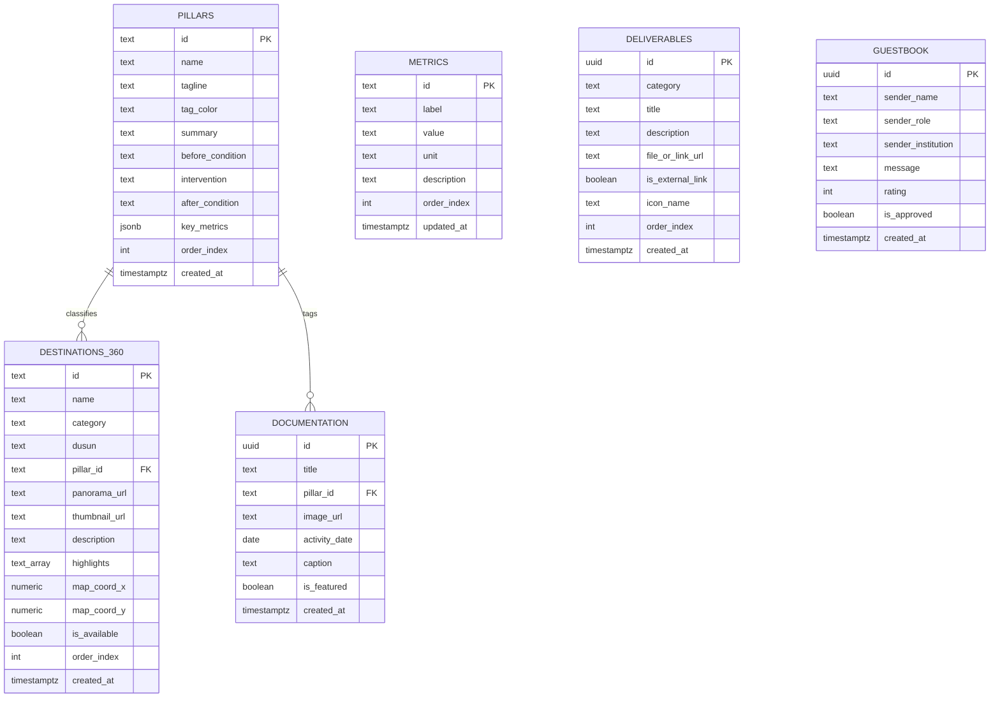

# Software Requirements Specification (SRS)
# IN WEST TAMP: Integrated Wellness-Tourism Area Tampirkulon
**Standar Spesifikasi Kebutuhan Perangkat Lunak Berdasarkan IEEE Std 830-1998 / ISO/IEC/IEEE 29148**

---

## 1. Pendahuluan (Introduction)

### 1.1 Tujuan Dokumen (Purpose)
Dokumen Software Requirements Specification (SRS) ini mendefinisikan spesifikasi kebutuhan teknis dan fungsional perangkat lunak untuk sistem **IN WEST TAMP (Integrated Wellness-Tourism Area Tampirkulon)**. Dokumen ini ditujukan sebagai panduan rekayasa perangkat lunak bagi tim pengembang frontend, arsitek sistem backend Supabase, penguji kualitas (QA), serta tim pengusul PPK Ormawa Himagi Universitas Tidar 2025 dalam merealisasikan platform web interaktif multi-halaman yang tangguh, aman, dan berkinerja tinggi.

### 1.2 Konvensi Dokumen (Document Conventions)
* Setiap kebutuhan diberi kode identifikasi unik:
  * `SF-[XX]`: *System Feature* (Fitur Sistem Utama)
  * `TR-[XX]`: *Technical Requirement* (Kebutuhan Teknis Arsitektural)
  * `NFR-[XX]`: *Non-Functional Requirement* (Kebutuhan Non-Fungsional)
  * `SEC-[XX]`: *Security Requirement* (Kebutuhan Keamanan)
* Tingkat prioritas kebutuhan diklasifikasikan menggunakan kata kerja baku:
  * **WAJIB (SHALL/MUST):** Kebutuhan mutlak yang harus tersedia agar sistem dapat beroperasi.
  * **DIANJURKAN (SHOULD):** Kebutuhan bernilai tinggi yang diimplementasikan kecuali terdapat kendala teknis krusial.
  * **OPSIONAL (MAY):** Kebutuhan pelengkap yang dapat diimplementasikan pada iterasi berikutnya.

### 1.3 Audiens Target dan Rekomendasi Baca (Intended Audience)
1. **Frontend Engineers:** Memahami struktur komponen React, routing halaman, penanganan WebGL Pannellum, dan konsumsi REST API Supabase.
2. **Backend/Database Engineers:** Mengimplementasikan skema relasional PostgreSQL, Row Level Security (RLS), dan Supabase Storage policies.
3. **UI/UX Designers & QA Testers:** Menguji kepatuhan antarmuka terhadap sistem desain kanvas obsidian dan kriteria uji fungsional.
4. **Dosen Pendamping & Juri PPK Ormawa:** Memverifikasi keselarasan arsitektur sistem dengan rubrik capaian program pengabdian.

### 1.4 Lingkup Proyek (Project Scope)
Sistem perangkat lunak IN WEST TAMP adalah aplikasi web multi-halaman berbasis web modern (Vite + React) yang terhubung dengan Backend-as-a-Service (BaaS) Supabase. Sistem mencakup:
* Portal informasi publik multi-halaman yang memaparkan profil PPK Ormawa, latar belakang masalah, 4 pilar program, capaian luaran wajib/tambahan, serta galeri dokumentasi.
* Modul imersif penampil panorama 360 derajat berbasis WebGL dengan dukungan sensor orientasi fisik smartphone (*gyroscope*) dan peta interaktif desa.
* Formulir publik interaktif buku tamu/ulasan juri dengan sanitasi data.
* Sistem manajemen konten terproteksi (`/admin`) dengan otentikasi JWT Supabase Auth untuk pemutakhiran data dinamis tanpa perlu deploy ulang kode sumber.

### 1.5 Dokumen Referensi (References)
* IEEE Std 830-1998: *Recommended Practice for Software Requirements Specifications*.
* ISO/IEC/IEEE 29148:2018: *Systems and software engineering - Life cycle processes - Requirements engineering*.
* W3C Web Content Accessibility Guidelines (WCAG) 2.1 Level AA.
* [PRD.md](file:///home/aniiporangbaik/development/projects/Landing%20Page%20Poster/PRD.md): *Product Requirements Document IN WEST TAMP Versi 2.0.0*.
* [desain.md](file:///home/aniiporangbaik/development/projects/Landing%20Page%20Poster/desain.md): *Design Tokens, Color Palette, and Motion Guidelines*.

---

## 2. Deskripsi Umum Sistem (Overall Description)

### 2.1 Perspektif Produk (Product Perspective)
Sistem IN WEST TAMP merupakan sistem berbasis arsitektur client-server modern (Jamstack + BaaS). Frontend di-hosting pada jaringan Edge CDN (Vercel / Cloudflare Pages), sementara penyimpanan data relasional, otentikasi pengguna admin, dan berkas biner (media gambar panorama dan foto kegiatan) dikelola oleh infrastruktur Supabase (PostgreSQL 15, PostgREST, dan GoTrue Auth).

```
┌────────────────────────────────────────────────────────────────────────┐
│                          PENGGUNA (CLIENT)                             │
│  Smartphone Juri / Wisatawan / Admin Laptop via HTTPS (TLS 1.3)        │
└───────────────────────────────────┬────────────────────────────────────┘
                                    │
                                    ▼
┌────────────────────────────────────────────────────────────────────────┐
│                        EDGE HOSTING (VERCEL CDN)                       │
│  - Static Assets Delivery (HTML5, React Bundles, Vanilla CSS Tokens)   │
│  - Client-Side React Router (/ , /tentang , /program , /tur-360 , dll) │
│  - Local Pannellum WebGL Engine                                        │
└───────────────────────────────────┬────────────────────────────────────┘
                                    │
                   REST (PostgREST) / HTTPS Auth API
                                    │
                                    ▼
┌────────────────────────────────────────────────────────────────────────┐
│                     SUPABASE BACKEND CLOUD (BaaS)                      │
│  ┌──────────────────────┐ ┌──────────────────┐ ┌────────────────────┐  │
│  │   PostgreSQL 15 DB   │ │   Supabase Auth  │ │  Supabase Storage  │  │
│  │ (RLS Protected Tables│ │ (JWT Token Check │ │ (panoramas-360,    │  │
│  │  Data 4 Pilar, Spot, │ │  Session Guard)  │ │  activity-photos,  │  │
│  │  Metrik, Guestbook)  │ │                  │ │  document-assets)  │  │
│  └──────────────────────┘ └──────────────────┘ └────────────────────┘  │
└────────────────────────────────────────────────────────────────────────┘
```

### 2.2 Karakteristik Pengguna (User Classes and Characteristics)

| Kelas Pengguna | Tingkat Hak Akses | Deskripsi & Kemampuan Teknis |
|---|---|---|
| **Pengunjung / Juri Penilai** | Akses Publik (`anon`) | Mengakses seluruh rute halaman publik, menjelajahi panorama 360°, mengaktifkan sensor gerak HP, membaca data luaran, dan mengirim ulasan pada formulir buku tamu. |
| **Administrator / Tim Ormawa** | Akses Penuh (`authenticated`) | Melakukan login melalui rute `/admin/login`, memiliki wewenang CRUD (Create, Read, Update, Delete) pada data metrik, dokumentasi, luaran, status spot 360°, dan moderasi buku tamu. |

### 2.3 Lingkungan Pengoperasian (Operating Environment)
1. **Perangkat Klien:**
   * Smartphone Android (OS 9.0+) dengan browser Google Chrome, Samsung Internet, atau Firefox.
   * iPhone iOS (iOS 13.0+) dengan browser Safari atau Google Chrome.
   * Laptop / Desktop (Windows, macOS, Linux) resolusi layar minimal 1024x768px.
2. **Kebutuhan Sensor Fisik:**
   * Sensor akselerometer dan giroskop (untuk fitur rotasi orientasi virtual tour).
3. **Infrastruktur Server:**
   * Edge CDN dengan dukungan HTTP/2 atau HTTP/3 dan kompresi Brotli/Gzip.
   * Supabase Cloud Platform (Region Asia-Southeast: Singapore) untuk meminimalkan latensi akses data (< 50ms).

### 2.4 Batasan Desain dan Implementasi (Design and Implementation Constraints)
1. **Framework Frontend:** Harus dibangun menggunakan Vite + React 18+ untuk memastikan modularitas komponen dan kecepatan build.
2. **Desain Visual:** Wajib mengikuti token visual dari [desain.md](file:///home/aniiporangbaik/development/projects/Landing%20Page%20Poster/desain.md) (latar obsidian `#0A0F0D`, font `Bebas Neue` untuk display, `Plus Jakarta Sans` untuk UI, dan `Inter` untuk body text).
3. **Penyajian 360 Derajat:** Wajib menggunakan pustaka WebGL ringan (Pannellum 2.5.7) tanpa memerlukan instalasi aplikasi pihak ketiga atau dependensi WebXR yang belum merata di semua browser mobile.
4. **Ukuran Bundle:** Initial bundle size JavaScript tidak boleh melebihi 150 KB (terkompresi gzip) untuk rute beranda publik.
5. **Ketergantungan Backend:** Akses data klien publik hanya boleh menggunakan kunci publik anonim (`anon_key`) yang diproteksi aturan Row Level Security (RLS) PostgreSQL.

### 2.5 Asumsi dan Ketergantungan (Assumptions and Dependencies)
1. Peramban pengguna mendukung standar ECMAScript 2020 (ES6+) dan WebGL 1.0/2.0.
2. Kamera perangkat seluler pengguna dapat memindai QR code standar yang mengarah ke URL produksi web.
3. Supabase Cloud beroperasi dengan ketersediaan minimal 99.9% (SLA penyedia).

---

## 3. Kebutuhan Antarmuka Eksternal (External Interface Requirements)

### 3.1 Antarmuka Pengguna (User Interfaces)
Antarmuka pengguna mengadopsi prinsip desain *Dark Editorial Magazine* dengan palet obsidian kontras tinggi.

#### UI-01: Breakpoints dan Layout Grid
* **Mobile Small:** 320px hingga 479px (Optimasi utama konteks scan poster).
* **Mobile Large / Tablet Portrait:** 480px hingga 767px.
* **Tablet Landscape / Laptop:** 768px hingga 1023px.
* **Desktop Standar:** 1024px hingga 1439px.
* **Wide Screen:** 1440px ke atas.

#### UI-02: Indikator Aksesibilitas Visual
* Setiap elemen interaktif yang menerima fokus keyboard wajib menampilkan garis batas:
  ```css
  :focus-visible {
    outline: 3px solid #E58B24;
    outline-offset: 3px;
  }
  ```
* Area sentuh target (*touch target*) tombol dan tautan di layar ponsel wajib memiliki luas minimal 44px x 44px.

### 3.2 Antarmuka Perangkat Keras (Hardware Interfaces)
* **HW-01: Sensor Orientasi Perangkat (DeviceOrientation):**
  Aplikasi membaca data sudut rotasi Euler: `alpha` (rotasi sumbu Z), `beta` (rotasi sumbu X), dan `gamma` (rotasi sumbu Y) dari hardware gyroscope smartphone untuk memutar kamera virtual 3D panorama secara proporsional.
* **HW-02: Layar Sentuh Multi-Touch:**
  Aplikasi menangani gestur cubit (*pinch*) dua jari untuk mengubah sudut pandang kamera (*Field of View / FOV*) pada rentang 50° hingga 110°.

### 3.3 Antarmuka Perangkat Lunak (Software Interfaces)
* **SW-01: Supabase JavaScript SDK (`@supabase/supabase-js`):**
  Digunakan untuk seluruh kueri database (PostgREST), autentikasi pengurus (GoTrue), dan transaksi unggah berkas (Storage API).
* **SW-02: Pannellum WebGL Engine (`pannellum`):**
  Digunakan untuk merender proyeksi equirectangular citra panorama 360° ke kanvas WebGL.
* **SW-03: React Router (`react-router-dom` v6+):**
  Digunakan untuk manajemen routing halaman SPA/MPA berbasis browser history API tanpa me-refresh seluruh halaman.

### 3.4 Antarmuka Komunikasi (Communications Interfaces)
* **COM-01: Protokol Transfer:** Seluruh komunikasi klien-server wajib menggunakan protokol aman HTTPS dengan sertifikat TLS versi 1.3.
* **COM-02: Format Data:** Semua pertukaran data API terstruktur menggunakan format JSON (JavaScript Object Notation).

---

## 4. Fitur Sistem dan Spesifikasi Kebutuhan Fungsional (System Features)

```
┌────────────────────────────────────────────────────────────────────────┐
│                        FITUR SISTEM UTAMA (SRS)                        │
├──────────────────────────┬─────────────────────────────────────────────┤
│ SF-01: Autentikasi Admin │ Login JWT, Sesi Terenkripsi, Route Guard    │
│ SF-02: Navigasi & Dock   │ Navbar Responsif & Mobile Floating Dock     │
│ SF-03: Hub Tur 360°      │ WebGL Pannellum, Gyroscope, Spot Selector   │
│ SF-04: Peta Desa Mini    │ Koordinat Titik Spot, Interaksi Realtime    │
│ SF-05: Modul 4 Pilar     │ Komparasi Sebelum-Sesudah, Tab Interaktif   │
│ SF-06: Metrik Capaian    │ Counter Animasi Sekali Jalan, Observer      │
│ SF-07: Galeri & Lightbox │ Filter Kategori Pilar, Modal Layar Penuh    │
│ SF-08: Manajemen Luaran  │ Katalog Dokumen SK/SOP, Viewer PDF/Link     │
│ SF-09: Buku Tamu Publik  │ Form Validasi, Rating Bintang, Moderasi     │
│ SF-10: Panel Kelola Data │ CRUD Metrik, Foto, Luaran, Spot 360         │
└──────────────────────────┴─────────────────────────────────────────────┘
```

---

### SF-01: Modul Autentikasi dan Otorisasi Administrator
* **Deskripsi:** Sistem otentikasi aman bagi tim pelaksana untuk mengakses antarmuka manajemen konten.
* **Prioritas:** WAJIB (MUST).

#### Kebutuhan Spesifik:
* **FR-AUTH-01:** Sistem HARUS menyediakan formulir login pada rute `/admin/login` yang menerima input alamat email dan kata sandi.
* **FR-AUTH-02:** Sistem HARUS memvalidasi kredensial melalui fungsi `supabase.auth.signInWithPassword()`.
* **FR-AUTH-03:** Sistem HARUS menolak akses ke rute terlindungi (`/admin/*`) dan mengarahkan pengguna tidak sah ke rute `/admin/login`.
* **FR-AUTH-04:** Sistem HARUS menyimpan token JWT sesi secara aman pada penyimpanan sesi browser dan memperbarui token (*refresh token*) secara otomatis sebelum masa kedaluwarsa habis.
* **FR-AUTH-05:** Sistem HARUS menyediakan fungsi logout yang membatalkan sesi (`supabase.auth.signOut()`) dan menghapus seluruh token dari browser.

---

### SF-02: Modul Navigasi dan Tata Letak Responsif
* **Deskripsi:** Menyediakan struktur navigasi multi-halaman yang konsisten di seluruh perangkat.
* **Prioritas:** WAJIB (MUST).

#### Kebutuhan Spesifik:
* **FR-NAV-01:** Sistem HARUS menampilkan Top Navigation Bar pada layar lebar (>= 768px) yang memuat logo resmi (Untidar, BLU, Desa Wisata, Kemendikbudristek), badge program, dan tautan rute:
  * Beranda (`/`)
  * Tentang (`/tentang`)
  * Program (`/program`)
  * Luaran (`/luaran`)
  * Tur 360° (`/tur-360`)
  * Dokumentasi (`/dokumentasi`)
  * Kontak (`/kontak`)
* **FR-NAV-02:** Sistem HARUS menampilkan *Mobile Floating Navigation Dock* pada perangkat dengan lebar layar < 768px.
* **FR-NAV-03:** Floating Dock HARUS memuat 4 pintasan utama (Beranda, Tur 360°, 4 Pilar, Luaran) dengan posisi tetap (*fixed*) di bagian bawah layar tanpa menghalangi konten baca.
* **FR-NAV-04:** Setiap tautan navigasi HARUS memiliki status visual aktif (*active indicator*) berwarna Solar Gold (`#E58B24`) saat rute sedang dibuka.

---

### SF-03: Modul Hub Virtual Tour Panorama 360 Derajat
* **Deskripsi:** Menampilkan visualisasi panorama 3D interaktif dari 7 spot destinasi wisata binaan desa.
* **Prioritas:** WAJIB (MUST).

#### Kebutuhan Spesifik:
* **FR-360-01:** Sistem HARUS memuat pustaka Pannellum WebGL untuk merender citra panorama equirectangular 2:1 pada kanvas penampil.
* **FR-360-02:** Sistem HARUS menampilkan daftar 7 spot destinasi dalam bentuk pemilih lajur horizontal (*horizontal pill selector*):
  1. Sunset di Persawahan (Spot 1 - Status: Siap)
  2. Basecamp Westtamp & Green Space (Spot 2)
  3. Sentra Pembuatan Keripik Tempe (Spot 3)
  4. Sentra Pembuatan Gula Jawa (Spot 4)
  5. Wisata Budaya Karawitan (Spot 5)
  6. Tuk Putri Mata Air Alami (Spot 6)
  7. Aliran Susur Sungai Tubing (Spot 7)
* **FR-360-03:** Ketika pengguna memilih salah satu spot, sistem HARUS memeriksa atribut `is_available`.
  * Jika `is_available == true`, sistem memuat berkas panorama resolusi tinggi dari URL terkait.
  * Jika `is_available == false`, sistem HARUS menampilkan modal/overlay informasi dengan pesan: *"Spot ini sedang dalam tahap dokumentasi bertahap bersama POKDARWIS Desa Tampirkulon"* dan menyajikan foto representatif serta deskripsi naratif potensi spot tersebut.
* **FR-360-04:** Sistem HARUS menyediakan kontrol rotasi otomatis (*autorotate*) berkecepatan lambat (-2 derajat/detik) yang otomatis berhenti saat pengguna melakukan interaksi sentuhan atau drag mouse.
* **FR-360-05:** Sistem HARUS menyediakan tombol *DeviceOrientation Gyroscope* ("Aktifkan Sensor HP"):
  * Pada iOS Safari (iOS 13+), sistem HARUS memanggil `DeviceOrientationEvent.requestPermission()`.
  * Jika izin diberikan (`permissionState === 'granted'`), sistem mengaktifkan pelacakan orientasi fisik perangkat.
  * Jika izin ditolak atau tidak didukung, sistem menampilkan notifikasi ramah dan mengembalikan kontrol ke mode gestur sentuh tanpa terjadinya crash aplikasi.
* **FR-360-06:** Sistem HARUS menyediakan kontrol zoom (tombol perbesar, perkecil, dan gestur cubit) serta tombol fullscreen layar penuh.

---

### SF-04: Modul Peta Interaktif Sebaran Spot Desa (Village Mini-Map)
* **Deskripsi:** Diagram denah interaktif yang memetakan posisi spasial ke-7 destinasi di wilayah Desa Tampirkulon.
* **Prioritas:** WAJIB (MUST).

#### Kebutuhan Spesifik:
* **FR-MAP-01:** Sistem HARUS menampilkan denah ilustrasi wilayah desa dengan titik pin penanda sesuai persentase koordinat `map_coord_x` dan `map_coord_y` dari database.
* **FR-MAP-02:** Pin lokasi spot yang sedang aktif pada viewer 360° HARUS ditandai dengan animasi denyut (*pulsing circle*) berwarna Solar Gold (`#E58B24`).
* **FR-MAP-03:** Klik pada pin lokasi di peta HARUS mengubah spot terpilih pada viewer 360° dan memperbarui kartu informasi detail spot.

---

### SF-05: Modul Paparan 4 Pilar & Komparasi Sebelum-Sesudah
* **Deskripsi:** Presentasi interaktif 4 pilar intervensi PPK Ormawa lengkap dengan data dukung lapangan.
* **Prioritas:** WAJIB (MUST).

#### Kebutuhan Spesifik:
* **FR-PIL-01:** Sistem HARUS memuat data 4 pilar dari tabel `pillars` di Supabase:
  * Pilar 1: *Tubing Care* (K3 & Standar Keselamatan Air)
  * Pilar 2: *West Integrated Ecosystem* (Kelembagaan POKDARWIS & Digitalisasi)
  * Pilar 3: *Local Creative Innovation* (Pemberdayaan PKK & Olahan Pangan Lokal)
  * Pilar 4: *Green Wellness Space* (Taman TOGA & Area Terbuka Sehat)
* **FR-PIL-02:** Setiap kartu pilar HARUS memiliki komponen toggle tab interaktif:
  * Tab A: **Hasil Intervensi Program** (menampilkan capaian terukur, foto fasilitas baru, dan sertifikasi).
  * Tab B: **Kondisi Sebelum Program** (menampilkan kendala awal, ketiadaan SOP, dan foto lahan tidur).
* **FR-PIL-03:** Transisi pergantian tab HARUS menggunakan animasi crossfade halus (durasi 250ms) tanpa lonjakan tata letak (*layout shift*).

---

### SF-06: Modul Penghitung Dampak Kuantitatif (Animated Metrics Counter)
* **Deskripsi:** Tampilan angka capaian resmi program PPK Ormawa yang bergerak saat masuk ke area pandang layar.
* **Prioritas:** WAJIB (MUST).

#### Kebutuhan Spesifik:
* **FR-MET-01:** Sistem HARUS memuat 6 metrik utama dari tabel `metrics`:
  * 4 Pilar Program Terpadu
  * 15 Mahasiswa Berdedikasi
  * 5 Bulan Masa Pengabdian
  * 6 Kelompok Sasaran Berdaya
  * 95% Lonjakan Kunjungan Wisatawan
  * 25 Pengelola Wisata Bersertifikasi K3
* **FR-MET-02:** Sistem HARUS menggunakan *Intersection Observer API* untuk mendeteksi saat kartu metrik masuk minimal 20% ke dalam viewport layar.
* **FR-MET-03:** Ketika terdeteksi masuk viewport, nilai numerik HARUS beranimasi bertambah (*count up*) dari 0 hingga nilai target dalam rentang waktu 1.5 detik.
* **FR-MET-04:** Animasi counter HARUS berhenti di nilai akhir dan TIDAK BOLEH berulang (*no infinite looping*).
* **FR-MET-05:** Kartu metrik HARUS menggunakan bentuk heksagonal CSS (`clip-path: polygon(...)`) sebagai representasi motif sel sarang lebah ekosistem terpadu.

---

### SF-07: Modul Galeri Dokumentasi dan Lightbox
* **Deskripsi:** Penampil dokumentasi visual kegiatan lapangan yang terorganisir per kategori pilar.
* **Prioritas:** WAJIB (MUST).

#### Kebutuhan Spesifik:
* **FR-GAL-01:** Sistem HARUS menyediakan tombol filter: *Semua*, *K3 & Tubing*, *POKDARWIS*, *UMKM & PKK*, dan *Lingkungan/Green Space*.
* **FR-GAL-02:** Memilih filter kategori HARUS menyaring daftar foto secara instan di sisi klien.
* **FR-GAL-03:** Klik pada salah satu foto HARUS membuka modal Lightbox beresolusi penuh.
* **FR-GAL-04:** Modal Lightbox HARUS menampilkan:
  * Gambar beresolusi tinggi.
  * Judul kegiatan dan tanggal pelaksanaan.
  * Tag pilar terkait.
  * Deskripsi/keterangan foto.
  * Tombol navigasi foto sebelumnya dan berikutnya.
  * Tombol tutup (bisa ditutup dengan menekan tombol silang, area luar gambar, atau tombol `Escape` pada keyboard).

---

### SF-08: Modul Katalog Luaran dan Dokumen Legalitas
* **Deskripsi:** Etalase dokumen hasil pengabdian masyarakat (luaran wajib dan luaran tambahan).
* **Prioritas:** WAJIB (MUST).

#### Kebutuhan Spesifik:
* **FR-LUAR-01:** Sistem HARUS mengelompokkan luaran ke dalam dua seksi terpisah: Luaran Wajib dan Luaran Tambahan.
* **FR-LUAR-02:** Setiap item luaran HARUS menyajikan judul, ringkasan manfaat, serta tombol aksi:
  * Tombol "Buka Dokumen / Preview PDF" untuk dokumen legalitas SK POKDARWIS dan SOP K3.
  * Tombol "Kunjungi Publikasi" untuk liputan media massa daring.
* **FR-LUAR-03:** Dokumen PDF yang disimpan di Supabase Storage bucket `document-assets` HARUS dapat dibuka langsung pada tab peramban baru.

---

### SF-09: Modul Buku Tamu dan Ulasan Interaktif
* **Deskripsi:** Fasilitas pengiriman masukan dan apresiasi dari juri kompetisi maupun pengunjung publik.
* **Prioritas:** WAJIB (MUST).

#### Kebutuhan Spesifik:
* **FR-GB-01:** Sistem HARUS menyediakan formulir pada rute `/kontak` dengan kolom input:
  * Nama Lengkap (Wajib, teks 3-100 karakter).
  * Peran / Kategori (Wajib, pilihan: Juri PPK Ormawa, Wisatawan, Dosen/Akademisi, Warga Desa, Umum).
  * Asal Instansi / Institusi (Opsional, teks maks 100 karakter).
  * Pesan / Kesan (Wajib, teks 10-1000 karakter).
  * Penilaian / Rating (Wajib, 1 hingga 5 bintang).
* **FR-GB-02:** Sistem HARUS melakukan validasi dan sanitasi input client-side untuk mencegah penyisipan kode berbahaya (XSS).
* **FR-GB-03:** Pengiriman form yang valid HARUS menyimpan data ke tabel `guestbook` di Supabase.
* **FR-GB-04:** Sistem HARUS menampilkan daftar ulasan yang disetujui (`is_approved == true`) di bawah formulir dengan pagination atau scroll halus.

---

### SF-10: Modul Antarmuka Panel Kelola Data (`/admin`)
* **Deskripsi:** Antarmuka visual bagi administrator untuk memanipulasi data tanpa membuka Supabase Studio.
* **Prioritas:** WAJIB (MUST).

#### Kebutuhan Spesifik:
* **FR-ADM-MET:** Admin HARUS dapat memperbarui label, angka capaian, dan deskripsi pada tabel `metrics`.
* **FR-ADM-DOC:** Admin HARUS dapat mengunggah berkas foto kegiatan baru (format JPG/PNG maks 3MB) ke Supabase Storage bucket `activity-photos` dan menyimpannya ke tabel `documentation` dengan memilih relasi pilar.
* **FR-ADM-LUAR:** Admin HARUS dapat menambah atau menghapus entri luaran pada tabel `deliverables` serta mengunggah berkas PDF pendukung ke bucket `document-assets`.
* **FR-ADM-360:** Admin HARUS dapat mengubah narasi spot, mengatur status `is_available`, dan memperbarui koordinat peta X & Y pada tabel `destinations_360`.
* **FR-ADM-MOD:** Admin HARUS dapat mengubah status `is_approved` pada ulasan buku tamu atau menghapus pesan spam.

---

## 5. Kebutuhan Data dan Spesifikasi Basis Data (Data Requirements)

### 5.1 Diagram Hubungan Entitas (Entity-Relationship Diagram)



### 5.2 Kamus Data dan Integritas Basis Data

#### Batasan Validasi Tabel (Integrity Constraints):
1. `pillars.id`: Nilai unik baku: `'tubing-care'`, `'integrated-ecosystem'`, `'local-creative'`, `'green-wellness'`.
2. `destinations_360.map_coord_x` & `map_coord_y`: Tipe `NUMERIC` rentang 0.00 hingga 100.00 (persentase koordinat kanvas peta).
3. `deliverables.category`: Pembatasan nilai `CHECK (category IN ('wajib', 'tambahan'))`.
4. `guestbook.rating`: Pembatasan nilai `CHECK (rating >= 1 AND rating <= 5)`.

---

## 6. Kebutuhan Non-Fungsional Perangkat Lunak (Non-Functional Requirements)

### 6.1 Kinerja dan Latensi (Performance Requirements)
* **NFR-PERF-01:** Halaman awal (Beranda) HARUS mencapai skor Google Lighthouse Performance minimal 90 pada emulasi perangkat seluler (Moto G Power / 4G Fast).
* **NFR-PERF-02:** First Contentful Paint (FCP) HARUS tercapai dalam waktu kurang dari 1.0 detik.
* **NFR-PERF-03:** Largest Contentful Paint (LCP) HARUS tercapai dalam waktu kurang dari 2.5 detik.
* **NFR-PERF-04:** Cumulative Layout Shift (CLS) HARUS berada di bawah skor 0.05.
* **NFR-PERF-05:** Pemuatan citra equirectangular 360 derajat HARUS bersifat asinkron dan menggunakan indikator loading visual (*loading spinner*) hingga WebGL siap menampilkan panorama.

### 6.2 Keandalan dan Ketersediaan (Reliability Requirements)
* **NFR-REL-01:** Aplikasi HARUS memiliki waktu aktif (*uptime*) 99.9% yang dijamin oleh Edge Hosting dan Supabase Platform SLA.
* **NFR-REL-02:** Jika terjadi kegagalan jaringan saat memanggil API Supabase, antarmuka klien HARUS menyajikan data fallback lokal (*graceful degradation*) sehingga konten halaman tetap terbaca dan tidak menampilkan layar kosong (*blank screen*).

### 6.3 Aksesibilitas dan Ergonomi (Accessibility & Usability Requirements)
* **NFR-A11Y-01:** Kontras warna teks utama putih `#F9FAFB` terhadap latar belakang `#0A0F0D` HARUS memiliki rasio kontras minimal 18.9:1 (melampaui WCAG AAA 7:1).
* **NFR-A11Y-02:** Kontras warna teks sekunder `#D1D5DB` terhadap kartu `#141E18` HARUS memiliki rasio kontras minimal 12.6:1 (melampaui WCAG AA 4.5:1).
* **NFR-A11Y-03:** Seluruh fungsionalitas interaktif (navigasi menu, pergantian tab pilar, pembukaan lightbox galeri, dan tombol viewer) HARUS dapat dioperasikan secara penuh menggunakan navigasi keyboard (`Tab`, `Enter`, `Space`, `Escape`, panah arah).
* **NFR-A11Y-04:** Antarmuka HARUS mendukung pembesaran ukuran teks (*text zoom*) hingga 200% tanpa menyebabkan pemotongan teks atau kerusakan tata letak kolom.

### 6.4 Keamanan Sistem (Security Requirements)
* **SEC-01: Row Level Security (RLS):**
  * Seluruh tabel PostgreSQL wajib mengaktifkan RLS (`ALTER TABLE ... ENABLE ROW LEVEL SECURITY`).
  * Aturan publik `anon` hanya memiliki hak `SELECT` (baca data aktif).
  * Aturan publik `anon` pada tabel `guestbook` hanya memiliki hak `INSERT` dengan pembatasan nilai kolom yang telah divalidasi.
  * Seluruh operasi mutasi data (`INSERT`, `UPDATE`, `DELETE`) pada tabel konten master hanya dapat dieksekusi oleh token JWT terotentikasi (`auth.role() = 'authenticated'`).
* **SEC-02: Kebijakan Penyimpanan (Storage Policies):**
  * Bucket penyimpanan biner berstatus publik untuk dibaca seluruh pengguna internet.
  * Operasi unggah berkas (`storage.objects.insert`) dan hapus berkas (`storage.objects.delete`) diproteksi penuh dan hanya diizinkan untuk pengguna admin terotentikasi.
* **SEC-03: Kunci API:** Kunci privat `service_role_key` TIDAK BOLEH ditanamkan ke dalam kode sumber klien frontend. Hanya kunci publik `anon_key` yang diperkenankan berada pada variabel lingkungan frontend (`VITE_SUPABASE_ANON_KEY`).

---

## 7. Matriks Keterlacakan Kebutuhan (Requirements Traceability Matrix)

Tabel berikut menghubungkan kebutuhan produk pada PRD dengan fitur teknis pada SRS:

| ID Kebutuhan PRD | Deskripsi Kebutuhan PRD | ID Fitur SRS | Modul Komponen Frontend Terkait |
|---|---|---|---|
| **FR-PUB-01** | Header Navigasi & Identitas Institusi | `SF-02` | `Navbar.jsx`, `BrandLogos.jsx` |
| **FR-PUB-02** | Hero Section & Quick Poster Action | `SF-02`, `TR-01` | `HeroSection.jsx`, `PosterCard.jsx` |
| **FR-PUB-03** | Halaman Profil PPK Ormawa & Desa | `SF-02` | `AboutPage.jsx`, `TeamGrid.jsx` |
| **FR-PUB-04** | Halaman 4 Pilar Intervensi Program | `SF-05` | `ProgramsPage.jsx`, `PillarTabs.jsx` |
| **FR-PUB-05** | Halaman Hasil & Luaran Program | `SF-08` | `DeliverablesPage.jsx`, `PdfViewer.jsx` |
| **FR-PUB-06** | Hub Tur Virtual Panorama 360° | `SF-03`, `SF-04` | `Tour360Page.jsx`, `PannellumViewer.jsx`, `VillageMap.jsx` |
| **FR-PUB-07** | Halaman Galeri Dokumentasi Kegiatan | `SF-07` | `GalleryPage.jsx`, `LightboxModal.jsx` |
| **FR-PUB-08** | Kontak & Buku Tamu Masukan Juri | `SF-09` | `ContactPage.jsx`, `GuestbookForm.jsx` |
| **FR-PUB-09** | Mobile Floating Navigation Dock | `SF-02` | `FloatingDock.jsx` |
| **FR-ADM-01..07**| Panel Manajemen Admin Supabase | `SF-01`, `SF-10` | `AdminLogin.jsx`, `AdminDashboard.jsx`, `AdminCrudViews.jsx` |
| **NFR-PERF / MOB**| Kecepatan < 1 detik & Responsif HP | `NFR-PERF`, `NFR-MOB` | Konfigurasi Vite Splitting & CSS Tokens |
| **NFR-A11Y / SEC**| Aksesibilitas WCAG AA & Proteksi RLS | `NFR-A11Y`, `SEC-01..03`| SQL Policies & Palette Contrast Ratios |

---

## 8. Skenario Pengujian dan Kriteria Penerimaan (Acceptance Test Scenarios)

### Uji 1: Alur Pemindaian QR Poster ke Portal Beranda (TC-01)
* **Kondisi Awal:** Poster fisik terpasang QR Code resmi hasil generate skrip.
* **Langkah Uji:**
  1. Penguji memindai QR code menggunakan kamera smartphone iPhone dan Android.
  2. Browser membuka tautan produksi web.
* **Kriteria Sukses:**
  * Waktu render beranda pertama kali di bawah 1.5 detik pada koneksi 4G.
  * Tampilan poster, judul IN WEST TAMP, dan tombol aksi tampil proporsional tanpa ada teks terpotong.
  * Floating Dock tampil di bawah layar ponsel tanpa menutupi konten.

### Uji 2: Pengoperasian Virtual Tour 360° dan Sensor Gyroscope (TC-02)
* **Kondisi Awal:** Halaman `/tur-360` dibuka pada smartphone bergiroskop.
* **Langkah Uji:**
  1. Pengguna menyentuh layar dan menggeser ke kiri/kanan/atas/bawah.
  2. Pengguna mengklik tombol "Aktifkan Sensor HP" dan memberikan izin browser.
  3. Pengguna menggerakkan smartphone ke arah langit dan sekeliling ruangan.
  4. Pengguna mengklik salah satu pin pada peta mini desa.
* **Kriteria Sukses:**
  * Gambar berputar mulus 60 FPS mengikuti gestur sentuhan.
  * Kamera panorama bergerak serempak sesuai arah pergerakan fisik smartphone saat sensor aktif.
  * Klik pin peta mengubah panorama dan indikator pin aktif berpindah dengan benar.

### Uji 3: Komparasi Sebelum-Sesudah 4 Pilar (TC-03)
* **Langkah Uji:**
  1. Buka halaman `/program`.
  2. Klik toggle tab "Kondisi Sebelum Program" pada pilar Tubing Care.
  3. Klik kembali toggle tab "Hasil Intervensi Program".
* **Kriteria Sukses:**
  * Konten teks, foto dokumentasi, dan metrik beralih mulus tanpa jeda dan tanpa pergeseran tata letak halaman.

### Uji 4: Pengiriman Pesan Buku Tamu (TC-04)
* **Langkah Uji:**
  1. Buka halaman `/kontak`.
  2. Masukkan data: Nama "Prof. Penilai", Peran "Juri PPK Ormawa", Pesan "Karya yang sangat luar biasa dan terintegrasi", Rating "5".
  3. Klik tombol "Kirim Masukan".
* **Kriteria Sukses:**
  * Data terkirim ke Supabase dengan kode status HTTP 201 Created.
  * Muncul toast notifikasi sukses: *"Terima kasih atas ulasan dan apresiasi Anda"*.
  * Ulasan langsung muncul pada daftar ulasan yang telah terverifikasi.

### Uji 5: Proteksi Rute dan Manajemen Konten Admin (TC-05)
* **Langkah Uji:**
  1. Pengguna tanpa login mencoba mengakses URL langsung `https://domain/admin/dashboard`.
  2. Sistem mengalihkan pengguna ke `/admin/login`.
  3. Admin memasukkan email dan kata sandi yang sah.
  4. Admin mengedit angka capaian metrik (misal: mengubah 95% menjadi 98%) dan klik simpan.
  5. Buka tab baru pada halaman beranda publik.
* **Kriteria Sukses:**
  * Rute admin terlindungi secara mutlak.
  * Pasca-update, halaman depan langsung menyajikan angka metrik terbaru tanpa perlu deploy ulang aplikasi.

---

*Dokumen SRS ini disahkan sebagai acuan rekayasa perangkat lunak resmi platform IN WEST TAMP PPK Ormawa Himagi Universitas Tidar 2025.*
