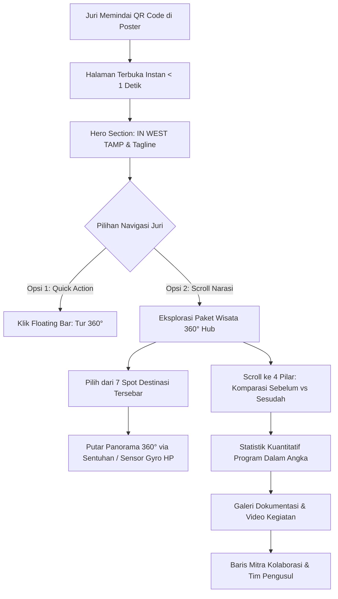

# Spesifikasi Desain: Landing Page PPK Ormawa "IN WEST TAMP"
**Sub-judul:** Integrated Wellness-Tourism Area Tampirkulon  
**Kategori Penilaian:** Poster Paling Kreatif (PPK Ormawa 2025)  
**Afiliasi:** Himagi Universitas Tidar (Untidar) | Kemendikbudristek - Belmawa - Diktisaintek  
**Tanggal:** 21 September 2026  
**Status:** Disetujui (Approved)

---

## 1. Latar Belakang & Tujuan Proyek

Proyek ini bertujuan membangun **landing page interaktif** yang diakses melalui pemindaian **QR Code pada poster hasil program PPK Ormawa "IN WEST TAMP"**. Poster ini diajukan untuk penilaian kategori **Poster Paling Kreatif**.

### Masalah & Peluang
- **Keterbatasan Poster Cetak:** Poster fisik berukuran terbatas (A1/A2/A3) dan hanya dapat menampilkan infografis statis.
- **Peluang "Creative Portal":** Menjadikan poster sebagai portal digital. Ketika juri memindai QR code dari smartphone, mereka disuguhkan tur virtual 360° yang imersif, eksplorasi rute paket wisata desa, perbandingan sebelum-sesudah interaktif dari 4 pilar program, serta metrik dampak yang terverifikasi.
- **Keunggulan Kompetitif di Mata Juri:**
  1. Membuktikan gagasan *"Empat Pilar, Satu Ekosistem"* secara nyata melalui integrasi wisata dan data capaian.
  2. Memberikan bukti fisik lokasi dan fasilitas melalui tur panorama 360° dengan sensor gerak HP (gyroscope).
  3. Akses cepat (< 1 detik) via Vercel / Cloudflare Pages tanpa hambatan loading lambat.

---

## 2. Alur Pengguna (User Journey)



---

## 3. Identitas Visual & Desain Sistem

Visual landing page dirancang selaras 100% dengan estetika poster cetak "IN WEST TAMP", memancarkan suasana *wellness, alam pedesaan, dan inovasi pemuda*:

| Unsur Desain | Spesifikasi | Penerapan |
|---|---|---|
| **Primary Green** | `#1B4332` & `#2D6A4F` | Header, aksen pilar *Green Wellness*, tombol utama |
| **Accent Orange/Gold** | `#E58B24` & `#D97706` | Aksen kata *"TAMP"*, pilar *Tubing Care*, badge highlight, rating |
| **Cream Surface** | `#FAF8F5` | Latar belakang halaman utama (warm & nyaman di mata) |
| **Dark Slate Text** | `#1F2937` & `#374151` | Teks judul dan deskripsi agar kontras tinggi & tajam di HP |
| **Pola Tekstur** | *Topographic Contour Lines* | Pola garis kontur bumi halus di latar belakang section |
| **Tipografi Heading** | `Plus Jakarta Sans`, sans-serif | Judul, angka metrik, dan tombol aksi |
| **Tipografi Body** | `Inter`, sans-serif | Narasi latar belakang desa, poin sebelum-sesudah |

---

## 4. Arsitektur Informasi & Rincian Komponen Halaman

### Section 1: Top Bar & Hero Header
- **Top Bar:** Logo resmi (Kemendikbudristek, Belmawa, Diktisaintek, Untidar, Himagi, PPK Ormawa) + pill badge *"Desa Wisata Tampirkulon"*.
- **Headline Utama:** "IN WEST TAMP"
- **Sub-headline:** "Integrated Wellness-Tourism Area Tampirkulon"
- **Tagline Filosofis:** *"Potensi besar, kini terintegrasi menjadi satu ekosistem wisata sehat & berkelanjutan."*
- **Konteks Wilayah:** Luas Wilayah 2.61 km² | ±4.893 Jiwa | 13 Dusun (Kec. Candimulyo, Kab. Magelang).
- **CTA Tombol:** 
  - Tombol Utama (Aksen Oranye): *"Jelajahi Paket Wisata 360°"* (scroll otomatis ke viewer).
  - Tombol Sekunder (Outline Hijau): *"Lihat Capaian 4 Pilar"*.

### Section 2: Virtual Tour Hub 360° ("Rute Paket Edu-Wellness Wisata")
Fitur unggulan untuk membuktikan kreativitas poster dengan menampilkan 7 spot destinasi wisata binaan PPK Ormawa yang tersebar di Desa Tampirkulon:
1. **Spot 1 (Aktif): Sunset di Persawahan** (Panorama lanskap senja di area persawahan asri Tampirkulon).
2. **Spot 2: Basecamp Westtamp Tubing & Green Space** (Pusat registrasi wisata air tubing, Taman TOGA, dan Angkringan Sehat).
3. **Spot 3: Sentra Pembuatan Keripik Tempe** (Eduwisata industri pangan rumahan unggulan desa).
4. **Spot 4: Sentra Pembuatan Gula Jawa** (Eduwisata proses nira kelapa tradisional).
5. **Spot 5: Wisata Budaya Karawitan** (Pelestarian kesenian musik gamelan warga).
6. **Spot 6: Tuk Putri** (Mata air alami bersejarah sebagai potensi wisata konservasi).
7. **Spot 7: Aliran Susur Sungai Tubing** (Jalur arung jeram air jernih dengan standar keselamatan K3).

**Fitur Kontrol Penampil 360°:**
- **Pannellum WebGL Engine:** Tampilan panorama jernih tanpa distorsi, rasio equirectangular 2:1.
- **Selector Spot (Horizontal Pill Bar):** Pengguna dapat memilih spot dengan satu sentuhan. Spot aktif memiliki indikator bercahaya.
- **Mode Sensor Gyroscope:** Tombol *"Aktifkan Sensor HP"* yang memanfaatkan API `DeviceOrientation`. Saat diaktifkan, juri cukup menggerakkan HP ke segala arah untuk melihat sekeliling.
- **Mode Fullscreen & Zoom:** Tombol pembesar layar penuh dan pinch-to-zoom dengan dua jari.
- **Village Mini-Map Modal:** Tombol *"Peta Sebaran Desa"* yang menampilkan diagram sebaran 7 titik lokasi di wilayah Tampirkulon.

### Section 3: Empat Pilar, Satu Ekosistem (Komparasi Interaktif)
Menyajikan hasil intervensi program secara mendalam dengan komponen kartu interaktif yang memiliki toggle/tab *"Sebelum"* vs *"Sesudah / Capaian"*:
- **Pilar 1: Tubing Care** (Dari pengelolaan risiko menuju kesiapan layanan)
  - *Sebelum:* Pengelola belum terstruktur dalam SOP keselamatan dan penanganan darurat air.
  - *Intervensi:* Pelatihan P3K bersama PMI, pelatihan K3 penyelamatan air bersama Basarnas, pelayanan kesehatan & Health Screening Day bersama Puskesmas.
  - *Capaian Kunci:* 25 pengelola bersertifikasi terlatih, 60 pengunjung mengikuti health screening.
- **Pilar 2: West Integrated Ecosystem** (Dari potensi terfragmentasi menuju ekosistem digital)
  - *Sebelum:* Pengelolaan wisata belum berbadan POKDARWIS dan promosi masih sangat tradisional.
  - *Intervensi:* Pembentukan SK POKDARWIS Desa Tampirkulon, pembuatan platform digital/website desa wisata, revitalisasi fasilitas basecamp.
  - *Capaian Kunci:* 19 anggota POKDARWIS aktif, 95% peningkatan kunjungan wisatawan.
- **Pilar 3: Local Creative** (Dari potensi mentah menuju produk bernilai ekonomi & edukasi)
  - *Sebelum:* Potensi budidaya ikan lele, TOGA, dan sentra keripik belum terintegrasi ke dalam paket wisata.
  - *Intervensi:* Pelatihan ibu-ibu PKK & KWT pembuatan produk olahan bakso lele bernilai jual, standarisasi kemasan UMKM, penyusunan buku panduan resep inovasi.
  - *Capaian Kunci:* 34 peserta ibu PKK & KWT terlatih, paket wisata edukasi kuliner resmi diluncurkan.
- **Pilar 4: Green Wellness Space** (Dari lahan tidur menuju ruang sehat produktif)
  - *Sebelum:* Area sekitar aliran tubing merupakan lahan kosong terlantar yang kurang sedap dipandang.
  - *Intervensi:* Pembangunan taman sehat percontohan, instalasi alat gym outdoor sederhana berbasis lokal, dan pendirian angkringan sehat ramah lingkungan.
  - *Capaian Kunci:* 21 m² area taman sehat terbangun, 6 varietas tanaman obat keluarga (TOGA) tertanam dan terawat.

### Section 4: Program Dalam Angka (Animated Impact Metrics)
Infografis dinamis dengan penghitung angka bergerak saat masuk viewport layar:
- **4** Pilar Program Terpadu
- **15** Mahasiswa Himagi Untidar Berdedikasi
- **5** Bulan Masa Pengabdian Intensif
- **6** Kelompok Sasaran Berdaya (Pengelola, PKK, KWT, Pemuda, Karang Taruna, UMKM)
- **95%** Lonjakan Volume Kunjungan Wisatawan
- **25** Pengelola Wisata Bersertifikasi K3 & P3K

### Section 5: Galeri Dokumentasi & Video Aksi
- Tab filter: *Semua*, *Pelatihan Basarnas & PMI*, *Edukasi UMKM & PKK*, *Pembangunan Taman Sehat*, *Aksi Tubing*.
- Lightbox popup foto resolusi tinggi saat foto diklik.
- Video embed dokumentasi kilas balik kegiatan pengabdian mahasiswa di desa.

### Section 6: Mitra Kolaborasi & Tim Pelaksana
- Baris logo institusi mitra pendukung:
  - Kemendikbudristek / Belmawa / Diktisaintek
  - Universitas Tidar & Himagi Untidar
  - Pemerintah Desa Tampirkulon & POKDARWIS
  - Basarnas Kantor Pencarian & Pertolongan
  - Palang Merah Indonesia (PMI)
  - Puskesmas Candimulyo & Posyandu
  - BPPSDMP (Kementerian Pertanian)
- Profil singkat Tim PPK Ormawa Himagi Untidar 2025.

### Section 7: Mobile Floating Navigation Dock
Dock melayang di bagian bawah smartphone juri (dengan blur glassmorphism):
- 🧭 *Tur 360°*
- 📊 *4 Pilar*
- 📈 *Dampak*
- 🗺️ *Peta Rute*

---

## 5. Arsitektur Teknis & Struktur Proyek

### Struktur Direktori
```
Landing Page Poster/
├── index.html              # Struktur semantic HTML5 utama + meta SEO/Social Share
├── package.json            # Konfigurasi dependensi Vite
├── vite.config.js          # Pengaturan build Vite
├── public/
│   ├── images/
│   │   ├── 360/            # File panorama 360 equirectangular (.jpg)
│   │   │   ├── sunset-persawahan.jpg  (Foto aktif yang sudah ada)
│   │   │   ├── basecamp-westtamp.jpg  (Placeholder spot 2)
│   │   │   ├── keripik-tempe.jpg      (Placeholder spot 3)
│   │   │   ├── gula-jawa.jpg          (Placeholder spot 4)
│   │   │   ├── karawitan.jpg          (Placeholder spot 5)
│   │   │   ├── tuk-putri.jpg          (Placeholder spot 6)
│   │   │   └── tubing-river.jpg       (Placeholder spot 7)
│   │   ├── logos/          # Logo mitra & kampus
│   │   └── documentation/  # Foto kegiatan pilar program
│   ├── favicon.ico
│   └── manifest.json
└── src/
    ├── styles/
    │   ├── main.css        # Variabel warna, tipografi, utility & layout
    │   ├── hero.css        # Desain hero & kontur background
    │   ├── viewer360.css   # Styling modul penampil 360 & kontrol
    │   └── pillars.css     # Styling kartu 4 pilar interaktif
    └── js/
        ├── main.js         # Entry point aplikasi & inisialisasi
        ├── spotsData.js    # Data modular konfigurasi 7 spot wisata 360
        ├── viewer360.js    # Logika Pannellum, lazy loading, gyro & navigasi spot
        └── counter.js      # Animasi angka metrik saat di-scroll
```

---

## 6. Rencana Verifikasi & Pengujian

1. **Responsivitas Layar:** Uji pada berbagai ukuran layar ponsel (iPhone SE, iPhone 14/15, Android Pixel/Samsung) dan laptop desktop.
2. **Kinerja Sensor HP:** Uji fungsi rotasi panorama via sentuhan jempol dan aktivasi sensor gerak HP (`DeviceOrientation`).
3. **Lazy Loading 360°:** Pastikan foto 360 hanya diunduh saat spot aktif dipilih, menjaga waktu buka pertama di bawah 1 detik.
4. **Deploy Staging:** Build produksi via `npm run build` dan uji pratinjau lokal sebelum rilis ke Vercel / Cloudflare Pages.
5. **QR Code Generator:** Verifikasi pembuatan QR Code dengan resolusi tinggi (SVG/PNG) yang mengarah tepat ke domain live.
